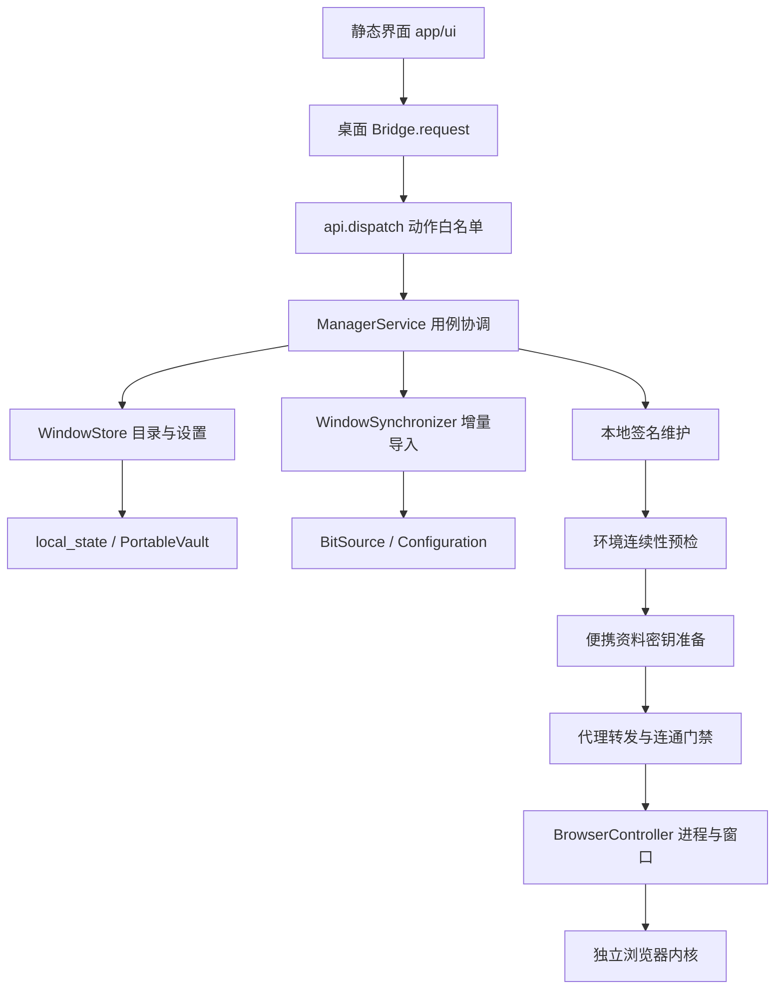

# 架构与功能

本文件描述当前实现；历史实验按`analysis/README.md`查找。窗口采用目录密钥、独立签名根和v2环境基线。窗口总数不写死，单次来源同步最多9999个。

## 1. 组成与边界

产品界面是静态HTML/CSS/JavaScript，由pywebview和随包WebView2承载；后台是Python模块，数据目录为当前`app/data`。没有前端打包流程、云端管理服务或系统常驻服务。代理转发只在窗口需要时按窗口启动独立worker。

`api.py`负责桥接动作与错误返回；`ManagerService`协调已有窗口的编辑和运行，偏好写入由`profile_preferences.py`处理。本地新建、随机指纹、复制窗口和旧配置新建导入实现已删除；历史脚本中对这些已删方法的直接调用不再支持。

## 2. 已实现功能

| 功能 | 当前行为 | 主要实现 |
|---|---|---|
| 列表管理 | 搜索、筛选、排序、分页、选择、最近打开时间及状态 | `ui/app.js`、`ManagerService.listing/statuses` |
| 窗口详情与保存 | 编辑名称、备注、分组、标签、代理、网址和已有偏好；指纹只读 | `profile_model.py`、`ManagerService.save` |
| 打开/前置/正常关闭 | 已开只前置，新开执行完整门禁；退出管理器默认保留浏览器 | `browser_core.py`、`local_browser.pyw` |
| 批量操作 | 打开、关闭、移入回收站、彻底删除；后端每次最多处理100个唯一ID | `api.py`、界面批量操作流程 |
| 回收站 | 归档和恢复保留资料，不做物理删除 | `WindowStore`、`ManagerService.archive` |
| 彻底删除 | 主列表与回收站均可单项/批量删除；正常关闭所选窗口，清理受管资料、配置、来源缓存、同步记录及可识别恢复副本；失败持久重试 | `profile_delete.py`、`delete_stores.py`、`delete_paths.py` |
| 分组 | 增删改名并更新窗口归属 | `groups_save`、加密settings |
| 代理配置 | 统一解析HTTP/HTTPS/SOCKS5、认证与IPv6地址格式，关闭后修改 | `proxy_config.py` |
| 代理检测 | 新开前经过浏览器实际使用的本地转发检测，前后确认worker身份；整轮网络检测最多10秒，备用源共用预算，失败不直连 | `proxy_check.py`、`ManagerService.open` |
| IP信息页 | 每次真实新开显示echoip官方信息页；复用并刷新已恢复的信息标签，已有窗口只前置 | `ip_info_page.py` |
| 窗口独立转发 | HTTP、CONNECT、SOCKS5远端DNS、WebSocket；TLS上游保留证书校验 | `proxy_runtime.py` |
| 代理隔离 | 锁定启动开关、禁QUIC/非代理UDP、阻止代理权限扩展冲突 | `browser_policy.py` |
| 增量导入 | 稳定来源键去重、只追加、不覆盖本地、不镜像来源删除 | `bit_source.py`、`window_sync.py` |
| 导入进度 | 单批9999、持久任务、部分成功计数、中断继续、取消后续项；轮询只取尾100及总计 | `sync_state.py`、同步后台任务与界面轮询 |
| 独立签名 | 本机密钥签发、合法格式验证、到期/时钟回拨时本地维护 | `local_signer.py`、`local_runtime.py` |
| 独立内核 | 21个精确构建部署、完整树校验和本机根绑定；旧构建保持不可变 | `core_specs.py`、`local_engine.py`、`signature_lifetime.py` |
| 目录便携 | AES-GCM目录密钥、路径重定位、OSCrypt同钥跨用户重新包装 | `portable_*.py` |
| 环境连续性 | 原机两次登记加第三次验证；新开前检查46项稳定输出；最多再试一次受限系统兼容参数，全部与旧基线一致才放行；临时验证使用后台模式 | `fingerprint_continuity.py`、`environment_compatibility.py` |
| 配置导出 | 导出加密配置，不含完整浏览器资料，不等于备份包 | `export_profiles` |
| 设置 | 启动页、下载目录、兼容内核路径、关闭确认和退出行为 | 加密settings及设置页面 |

本地新建、随机指纹、复制窗口和旧配置新建导入已从生产代码移除，不再只是隐藏入口。已有窗口保存、来源增量导入、旧目录迁移、核心升级备份和资料恢复仍保留。`defaults/ua_for`用于确定性的格式补齐，不生成随机指纹。

## 3. 数据与加密

`windows.sqlite`包含三张资料业务表及三张同步状态表：

| 表 | 用途 |
|---|---|
| `profiles` | ID、唯一递增序号、时间、归档状态和加密完整记录 |
| `settings` | 分组、应用设置与迁移标记等加密值 |
| `source_bindings` | 唯一来源键到独立本地窗口的绑定 |
| `sync_jobs` | 任务状态、总计、取消与恢复状态 |
| `sync_items` | 持久选择、逐项结果及有界查询索引 |
| `import_intents` | 认证的暂存/发布身份及prepared记录，协调文件系统和目录提交 |

数据库连接保留WAL与FULL同步；导入绑定和窗口记录同事务提交。站点Cookie、密码、历史、LocalStorage、IndexedDB、会话等属于完整profile文件树，不嵌入目录数据库。

`prepared-sources.sqlite`按来源ID加密保存新来源的完整配置、原生载荷及准备时关键资料状态；已有独立副本不依赖这个缓存日常运行。旧`local-source-archive.bin`继续兼容读取，内部使用按文件身份缓存，避免每个来源整包反复解密。

加密记录中的重要私有字段：

| 字段 | 含义 |
|---|---|
| `_runtime` | 受管资料、内核、签名路径和运行参数；持久化路径使用`@data/`、`@app/` |
| `_native` | 已编译的原生指纹和DataProtect配置 |
| `_source*` | 来源身份、完整元数据及复制快照 |
| `_portable_crypt` | 原OSCrypt主密钥的目录加密保存值 |
| `_continuity` | 探针版本、绑定摘要与稳定信号基线 |
| `_prefs_dirty`等 | 偏好写入、Cookie准备和恢复所需状态 |

前端公开记录剔除所有下划线私有字段及指纹中的保护配置。表单实际需要的代理/账号字段仍仅在本机界面流转，不得在诊断、日志、报告或外部服务中回显。

目录AES-GCM保护元数据及签名私钥。Windows DPAPI只保留旧格式升级、历史备份读取，以及浏览器在当前用户下的OSCrypt运行包装；站点数据库继续使用原主密钥，迁移不重新生成Cookie/密码密文。复制时必须保留目录密钥；丢失、损坏或错根一律拒绝，不能重建空钥匙冒充恢复。

## 4. 新窗口启动顺序

1. 读取记录、核实归档及真实进程状态；已有窗口只前置。
2. 验证旧签名/密文；需要时只在本机续签并原子提交新指纹文件。
3. 后台使用独立空profile及回环安全页面检查环境基线，不显示验证窗口，不触碰账号Sessions。先测原始参数；只有稳定差异时才根据旧基线尝试一次系统动画偏好/D3D11兼容参数，仍需46项完整、稳定且全等。临时参数只用于本次开窗，不写回旧基线、原生配置或持久记录。
4. 检查账号资料已关闭；认证v10数据库，必要时用当前用户重新包装同一OSCrypt钥匙。
5. 验证/定位固定的独立内核，更新受管runtime，写入用户明确修改的偏好。
6. 准备独立代理worker，核实身份与就绪；指定代理的真实新启动通过该worker做连通检测，随后再次确认worker存活与归属。
7. 控制器验证内核/配置摘要和签名，检查参数与扩展冲突，然后创建进程。
8. 核实进程创建时间、路径、资料、调试端口及可见窗口，更新最后打开时间。
9. 使用现有CDP接口显示`https://ifconfig.co/`，已有同网址标签只刷新并前置，不替换其他标签。网页由浏览器自身访问，因此沿用该窗口的代理。IP页控制失败会明确报告并保留已打开窗口。

若最初判为已开而实例恰好退出，本次不直接重启，要求再次点击，确保不能跳过新窗口门禁。进程、控制接口、真实可见窗口是三个不同状态，不可互相代替。

## 5. 导入与迁移

普通导入始终以本机完整资料为候选。读取当前来源资料根目录，单次枚举进程，按规范化GUID派生稳定来源键；名称、来源序号、本地路径均不参与认领。新来源首次缺配置或准备凭据过期时，仅对本机已发现的ID使用正常登录会话读取完整配置，不列云端窗口；冻结来源最后出口的派生环境，拒绝随机重生成，随后本机签名。日常开窗不回原厂。

准备缓存绑定来源关键文件的身份、时间、长度和内容摘要；准备前后或重试前来源变化会重新准备或拒绝，不能用旧配置配新资料。复制先检查关闭状态、链接/边界和磁盘预算，再暂存整个profile并校验源清单。发布前完成同钥认证、两次冷启动基线登记及第三次验证；只使用独立空probe，不访问账号站点。

130以下的已核实内核允许原厂`DataProtect:null`，必须明确实际major，不能把新版缺密钥当旧格式；Cookie和密码仍经过OSCrypt同钥认证。原厂实际启动缓存存在时验证RSA、稳定文件和所有静态配置，只冻结已认证的运行种子及明确的IP派生位置。正常关闭清掉缓存时按UA版本取得Google签名种子，验签后首次固定并记录导入说明，不宣称还原已丢失的历史种子。以后启动、续签和移动仍只使用已保存本地载荷。详见[全部内核适配验证](全部内核适配验证.md)。

从首个暂存写入起认证intent和work所有权。记录prepared副本与签名摘要后无覆盖发布，最后在同事务写窗口、唯一绑定、任务项成功。提交结果不确定先权威读回，不能删除可能已提交资料；清理失败仅计warning。重启标记interrupted，校验日志后恢复；伪造/旧未认证日志和未知目录仅保留拒绝。取消仍只停止后续项。

`local_migration.py`负责从旧模式准备完整配置、本机签名根及独立副本；`portable_migration.py`负责目录加密、OSCrypt密钥映射和状态切换。两者都是显式迁移入口，不能作为普通无引用代码删除。迁移未完成的状态会阻止正常开窗。

## 6. 模块分层

| 层 | 文件 |
|---|---|
| 入口/桥接 | `local_browser.pyw`、`api.py` |
| 用例协调 | `manager_service.py`、`profile_preferences.py` |
| 受管窗口彻底删除 | `profile_delete.py`协调关闭与恢复计划；`delete_stores.py`识别并定点清理存储；`delete_paths.py`验证路径及删除普通文件树 |
| 目录与数据模型 | `window_store.py`、`profile_model.py` |
| 公共平台基础 | `app_paths.py`、`local_state.py`、`browser_processes.py` |
| 浏览器生命周期 | `browser_core.py` |
| 代理与约束 | `proxy_config.py`、`proxy_check.py`、`proxy_runtime.py`、`browser_policy.py`、`ip_info_page.py` |
| 来源/增量导入 | `bit_source.py`、`local_source.py`、`source_database.py`、`window_sync.py`、`sync_state.py`、`import_preparation.py` |
| 配置/资源 | `configuration.py`、`config_factory.js`、`font_assets.py` |
| 内核/签名 | `engine_store.py`、`local_engine.py`、`local_signer.py`、`signature_lifetime.py`、`local_runtime.py` |
| 便携/迁移 | `portable_vault.py`、`portable_browser.py`、`portable_paths.py`、两类`*_migration.py` |
| 环境检查 | `fingerprint_continuity.py`、104后台隔离桌面`probe_display.py` |

`browser_core`保留原有公共名重导出，避免破坏历史工具；新代码的基础路径、错误、存储和占用检查应直接依赖对应小模块。原生模块的部分函数内导入用于避免加载环，不应机械提升到模块顶层。

## 7. 已知边界

- 支持21个已核实精确构建及v10资料；未知构建、Firefox、v20/App-Bound明确拒绝。相同主版本的新build也需另行核实，不能只加版本号。
- 已选择保留旧指纹，只接受通过原基线的设备。GitHub Windows 2022/2025原有9项差异中，隔离测量的系统兼容参数可消除3项，但Canvas、字体、设备类型及WebGL像素仍有6项差异；不以重登记或伪造输出来放行。跨设备支持尚未达到发版条件。详见[发版与跨设备验收](发版与跨设备验收.md)。
- 登录资料迁移需保留整个profile、会话恢复设置和目录密钥；只迁Cookie不足以覆盖依赖SessionStorage或IndexedDB的站点。资料完整不能保证服务端未过期、未撤销凭证，或永不要求重新验证。
- 46项环境检查不能证明全部物理硬件特征或平台风控一致；基线不能在新机器自动覆盖。
- 代理是浏览器受管路由，不是Windows内核级网络沙箱；任意恶意扩展、注入或外部程序超出当前保证。
- 代理探测的整轮网络预算为10秒，含备用站点；DNS、TLS或持续慢流阻塞由临时检测进程的超时终止处理，停止后不接受迟到的成功结果。该进程仅检测期间运行，不是常驻服务。
- 历史回归可能调用旧原厂模式或真实代理；只能由明确的专项入口运行，不能把`analysis/*.py`全部执行一遍。
- 彻底删除限本程序管理的窗口数据和可识别恢复副本；保留原比特来源、手动导出、外部下载/备份及共用内核和密钥。原来源仍在时可以再次导入。普通文件删除不保证抹除磁盘底层或系统快照的取证痕迹。详见[窗口彻底删除](窗口彻底删除.md)。
- 9999单批和1万条总记录已做合成映射/恢复验证；真实资料实测为当前11份。首次逐窗配置、复制和环境登记有实际耗时，不能据合成事务测试承诺真实万窗口吞吐；进程崩溃验证不等于所有硬件断电保证。
