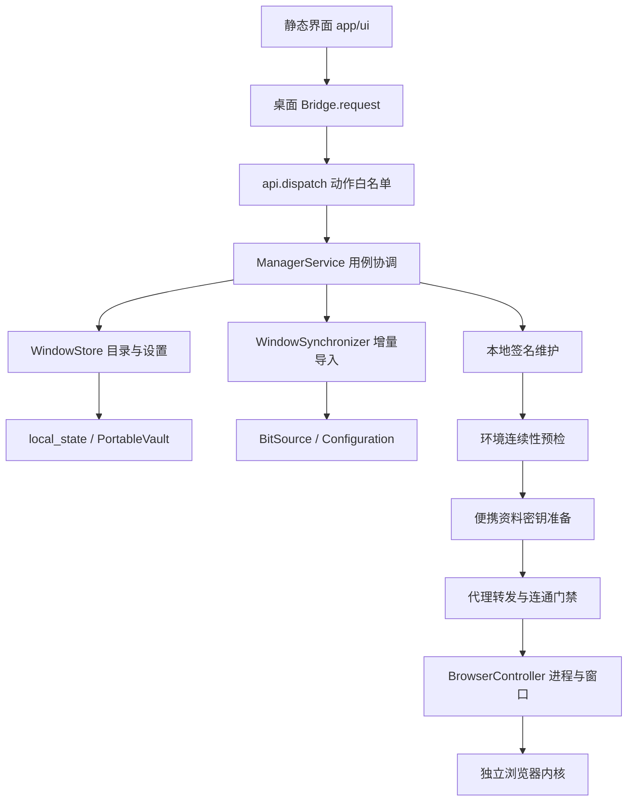

# 架构与功能

本文件描述当前实现；历史实验按`analysis/README.md`查找。窗口采用目录密钥、独立签名根和v2环境基线。窗口总数不写死，单次来源同步最多9999个。

原厂云端恢复与本地完整资料迁移、新建指纹字段及未对齐范围，见[2026-11-10深度对齐复核](深度对齐复核-20261110.md)。其中分别标明本次实测、历史证据、静态推导和仍未验证项，不能将有限样本通过表述为所有账号与设备完全一致。

## 1. 组成与边界

产品界面是静态HTML/CSS/JavaScript，由pywebview和随包WebView2承载；后台是Python模块，数据目录为当前`app/data`。没有前端打包流程、云端管理服务或系统常驻服务。代理转发只在窗口需要时按窗口启动独立worker。

`api.py`负责桥接动作与错误返回；`ManagerService`协调已有窗口的编辑和运行，偏好写入由`profile_preferences.py`处理。新本地创建由`WindowCreator`负责，与来源导入共用提交日志、工作租约和恢复机制；旧`create/copy/randomize/import_profiles`动作保持关闭，历史脚本对这些旧方法的调用不再支持。

## 2. 已实现功能

| 功能 | 当前行为 | 主要实现 |
|---|---|---|
| 列表管理 | 名称/备注/代理IP等最多10项批量搜索、筛选、排序、分页、选择、固定表头、最近打开时间及状态 | `ui/app.js`、`ManagerService.listing/statuses` |
| 窗口详情与保存 | 编辑名称、备注、分组、标签、代理、网址和已有偏好；指纹只读 | `profile_model.py`、`ManagerService.save` |
| 打开/前置/正常关闭 | 已开只前置，新开执行完整门禁；退出管理器默认保留浏览器 | `browser_core.py`、`local_browser.pyw` |
| 已开窗口排列 | 重置筛选后的一键排列与独立设置；自适应、宫格、对角线，显示器/位置/尺寸/间距/序号；仅调整本包已确认归属的桌面窗口 | `window_layout.py`、`window_layout_win32.py`；[窗口排列](窗口排列.md) |
| 批量操作 | 打开、关闭共享10个并行工作线程，同一窗口的操作保持互斥；已部署内核的完整只读校验并行，同批次仅在受保护文件句柄存活期间复用摘要，全部工人收尾后释放；内核发布仍加锁；移入回收站、彻底删除保留原顺序；每次最多100个唯一ID | `batch_operations.py`、`engine_validation.py`、`api.py`、界面批量操作流程 |
| 回收站 | 归档和恢复保留资料，不做物理删除 | `WindowStore`、`ManagerService.archive` |
| 彻底删除 | 主列表与回收站均可单项/批量删除；正常关闭所选窗口，清理受管资料、配置、来源缓存、同步记录及可识别恢复副本；失败持久重试 | `profile_delete.py`、`delete_stores.py`、`delete_paths.py` |
| 分组 | 增删改名并更新窗口归属 | `groups_save`、加密settings |
| 代理配置 | 统一解析HTTP/HTTPS/SOCKS5/SSH、认证与IPv6地址格式，关闭后修改 | `proxy_config.py`、`ssh_proxy.py` |
| 代理检测 | 新开前经过浏览器实际使用的本地转发检测，前后确认worker身份；整轮网络检测最多10秒，备用源共用预算，失败不直连 | `proxy_check.py`、`ManagerService.open` |
| IP信息页 | 每次真实新开默认显示echoip官方信息页，本地新建窗口可关闭；先确认新专用页再替换首个精确匹配旧页，其他标签保留，已有窗口只前置 | `ip_info_page.py` |
| 窗口独立转发 | HTTP、CONNECT、SOCKS5远端DNS、WebSocket；TLS上游保留证书校验 | `proxy_runtime.py` |
| 代理隔离 | 锁定启动开关、禁QUIC/非代理UDP、阻止代理权限扩展冲突 | `browser_policy.py` |
| 增量导入 | 最多5项并行，先预览再核对；稳定来源键去重、只追加、不覆盖本地、不镜像来源删除；每项独立进度、事务和恢复日志 | `bit_source.py`、`window_sync.py`、`sync_executor.py` |
| 导入进度 | 单批9999、持久任务、批次已处理百分比与当前窗口阶段进度；实际复制/校验容量、落盘文件数、后台验证轮次及耗时；中断继续、取消后续项；轮询只取尾100及总计 | `sync_state.py`、`import_progress.py`、同步后台任务与界面轮询 |
| 本地创建 | 单个/批量1000、21个精确内核、可编辑创建指纹、随机或同指纹、逐项代理、加密持久任务和幂等恢复 | `window_create.py`、`creation_fingerprint.py` |
| 新建专属启动设置 | 可选按IP匹配/每次随机，保留同一资料密钥；动态提取代理、IP/国家门禁、IP页开关及显式清理 | `created_window.py`、`dynamic_proxy.py` |
| 独立签名 | 本机密钥签发、合法格式验证、到期/时钟回拨时本地维护 | `local_signer.py`、`local_runtime.py` |
| 独立内核 | 21个精确构建的启动及延迟验签根、完整树校验和本机根绑定；Windows明确访问失败在无新暂存残留且可确认时最多再尝试一次，完整性错误仍拒绝；旧构建保持不可变 | `core_specs.py`、`local_engine.py`、`signature_lifetime.py` |
| 本地会话保存与恢复 | 按最新已初始化原生会话判断恢复；首次导入无可恢复会话时，已验证148构建可一次性恢复完整标签组快照，其余走兼容网址回退；歧义分组拒绝，成功后不再重放；异常退出保留备份恢复 | `session_recovery.py`、`source_sessions.py`、`browser_core.py` |
| 目录便携 | AES-GCM目录密钥、路径重定位、OSCrypt同钥跨用户重新包装 | `portable_*.py` |
| 覆盖更新 | 将完整新版包覆盖原目录后正常启动；独立载荷校验、程序事务替换及中断恢复自动完成，资料与已有内核留原位；现有v0.2.7发行ZIP未改动 | `tools/portable_bootstrap.py`、`tools/inplace_update.py`、`update_guard.py`；[原地更新](原地更新.md) |
| 环境连续性 | 原机登记仍要求严格一致；新开前后台检查46项，21个已认证精确构建采用有界设备差异策略，其余变化仍拒绝；不改原生配置或旧基线 | `fingerprint_continuity.py`、`environment_compatibility.py` |
| 配置导出 | 导出加密配置，不含完整浏览器资料，不等于备份包 | `export_profiles` |
| 设置 | 启动页、下载目录、兼容内核路径、关闭确认和退出行为 | 加密settings及设置页面 |

全局设置与窗口的待应用标记在同一数据库事务提交，任何一项写入失败均回滚。续签和偏好保存若遇到提交结果不确定，只有权威读回确认新签名未被引用才清理；读回失败保留文件供重试。导入暂存清理与删除复用同一归属验证逻辑，归属凭据最后移除，文件占用解除后可继续清理。

本地创建使用独立的新动作；随机与启动清理只作用于显式创建的`created_locally`记录。已导入窗口仍保持原指纹只读，不进入新生成器、自动按IP匹配或启动清理。复制窗口和旧配置新建导入保持关闭。`defaults/ua_for`仍用于确定性格式补齐。

创建的原厂默认噪声例外、版本匹配公开签名种子缓存、移动屏幕和首次尺寸见[本地窗口创建](本地窗口创建.md)。WebRTC替换模式纳入出口采样与最终代理门禁；新建的自动环境重算在本地签名维护后进行。每次新开按已保存的允许/禁用开关准备剪贴板权限，不重新计算导入指纹；正常已开窗口仍只前置。

## 3. 数据与加密

`windows.sqlite`包含三张资料业务表、三张同步状态表及两张创建状态表：

| 表 | 用途 |
|---|---|
| `profiles` | ID、唯一递增序号、时间、归档状态和加密完整记录 |
| `settings` | 分组、应用设置与迁移标记等加密值 |
| `source_bindings` | 唯一来源键到独立本地窗口的绑定 |
| `sync_jobs` | 任务状态、总计、取消与恢复状态 |
| `sync_items` | 持久选择、逐项结果及有界查询索引 |
| `import_intents` | 认证的暂存/发布身份及prepared记录，协调文件系统和目录提交 |
| `creation_jobs` | 幂等请求摘要、批次状态与取消标记 |
| `creation_items` | 固定随机结果、独立来源键、逐项结果与加密待处理配置；成功或取消后清除配置 |

数据库连接保留WAL与FULL同步；导入绑定和窗口记录同事务提交。站点Cookie、密码、历史、LocalStorage、IndexedDB、会话等属于完整profile文件树，不嵌入目录数据库。

状态轮询每轮读取当前目录记录并核验目录密钥，只复用密文内容未变的展示字段；缓存最多2048项，不保留完整私有记录，全部受管路径每轮重新解析和检查边界。展示缓存使用独立锁，解密和路径检查不占用目录库写锁。正式读取、保存和开窗仍重新解密。连接先查询当前日志模式，仅非WAL时设置并核验，每次连接继续明确设置FULL，逐项提交与恢复机制不变。

列表签名状态使用独立的有界展示缓存，核对文件身份、大小和时间，每次重新计算是否到期，最长30秒重新读取；缺失或读取失败不沿用旧有效状态。续签换路径、文件替换和删除会失效。此缓存不参与正式开窗的签名或完整性校验。前端复用排序器，搜索停止输入150毫秒后应用；中文组词期间不提交，清空立即应用，等待期间选择仍对应当前显示的行。

`prepared-sources.sqlite`按来源ID加密保存新来源的完整配置、原生载荷及准备时关键资料状态；已有独立副本不依赖这个缓存日常运行。旧`local-source-archive.bin`继续兼容读取，内部使用按文件身份缓存，避免每个来源整包反复解密。

准备身份还绑定Cookie、密码库及WAL/SHM/journal、标签快照和原生会话的有界双轮内容摘要及缺失状态。旧缓存缺少此证明时重新准备；不通过跨操作摘要缓存省略来源变化核对。它证明本机准备时点，不能证明未下载的云端配置永远最新。

加密记录中的重要私有字段：

| 字段 | 含义 |
|---|---|
| `_runtime` | 受管资料、内核、签名路径和运行参数；持久化路径使用`@data/`、`@app/` |
| `_native` | 已编译的原生指纹和DataProtect配置 |
| `_source*` | 来源身份、完整元数据及复制快照 |
| `_portable_crypt` | 原OSCrypt主密钥的目录加密保存值 |
| `_continuity` | 探针版本、绑定摘要与稳定信号基线 |
| `_prefs_dirty`等 | 偏好写入、Cookie准备和恢复所需状态 |
| `_startup_cookies` | 原厂启动Cookie快照已一次性落入本地资料的私有标记，之后不重放旧快照 |

前端公开记录剔除所有下划线私有字段及指纹中的保护配置。表单实际需要的代理/账号字段仍仅在本机界面流转，不得在诊断、日志、报告或外部服务中回显。

目录AES-GCM保护元数据及签名私钥。Windows DPAPI只保留旧格式升级、历史备份读取，以及浏览器在当前用户下的OSCrypt运行包装；站点数据库继续使用原主密钥，迁移不重新生成Cookie/密码密文。复制时必须保留目录密钥；丢失、损坏或错根一律拒绝，不能重建空钥匙冒充恢复。

## 4. 新窗口启动顺序

1. 读取记录、核实归档及真实进程状态；已有窗口只前置。
2. 验证旧签名/密文；需要时只在本机续签并原子提交新指纹文件。旧独立构建自动以新目录补齐延迟验签根，字节还原证明保持旧环境基线。
3. 后台使用独立空profile及受控HTTPS页面检查环境基线，不显示验证窗口，不触碰账号Sessions。固定验证页由Chromium CDP Fetch直接提供，不创建本机HTTP监听或服务线程；只接受同会话、同主frame、精确随机地址的GET文档请求，原离线代理和DNS限制保留。导入登记和直接校验默认仍严格；正式开窗对全部21个已认证精确独立构建采用同一套9字段设备差异策略，并检查类型/结构。其中屏幕媒体查询只允许动画偏好变化；缺项、不稳定、UA/时区/音频等其他变化以及配置/内核绑定变化仍拒绝。只有允许范围内的差异时使用原始参数，一次探针完成，不额外强制GPU设置；其他情况保留最多一次受限兼容参数重试。原生配置、旧基线、Cookie有效期及持久运行参数均不改。
4. 检查账号资料已关闭；认证v10数据库，必要时用当前用户重新包装同一OSCrypt钥匙。
5. 验证/定位固定的独立内核，更新受管runtime，写入用户明确修改的偏好。
6. 准备独立代理worker，核实身份与就绪；指定代理的真实新启动通过该worker做连通检测，随后再次确认worker存活与归属。
7. 控制器验证内核/配置摘要和签名，检查参数与扩展冲突，然后创建进程。
   Windows 在最后一次资料准备后，为 `--user-data-dir` 选择已存在且同目录身份可证明的较短拼写；持久路径、Cookie、指纹和104内核工作目录不变。仅枚举资料路径及目录元数据，检查现存成员的 UTF-16 路径长度；没有可用安全拼写、链接或目录变化、检查未完成时在创建进程前停止，不能把未能读取的会话资料当成空资料。检查有百万条目、128层及10秒观察预算，不是操作系统调用的硬超时或未来新增文件的长度保证。
8. 异常退出且有可读会话时先备份原生恢复资料，再修复退出标记；继续通过原生启动开关恢复，不重写受保护的启动页偏好。核实进程创建时间、路径、资料、调试端口及可见窗口，更新最后打开时间。
9. 使用浏览器级CDP接口创建并确认新的`https://ifconfig.co/`专用页（本地新建窗口明确关闭IP页时跳过），随后再次确认本轮初始快照中的首个旧信息页仍精确匹配该网址，才关闭旧页；其他账号和信息标签保留。新页地址提交、旧页关闭及前置在共享的最多5秒确认预算内完成，各调用使用剩余时间，仅重查状态，不重复创建或关闭。新页已导航到非信息网址时拒绝；旧页已消失或转为其他网址时不关闭。网页沿用该窗口的代理，不等待外部HTTP加载成功。任何IP页控制或确认失败都明确报告并保留现有窗口。

若最初判为已开而实例恰好退出，本次不直接重启，要求再次点击，确保不能跳过新窗口门禁。进程、控制接口、真实可见窗口是三个不同状态，不可互相代替。

## 5. 导入与迁移

普通导入始终以本机完整资料为候选。读取当前来源资料根目录，单次枚举进程，按规范化GUID派生稳定来源键；名称、来源序号、本地路径均不参与认领。新来源首次缺配置或准备凭据过期时，仅对本机已发现的ID使用正常登录会话读取完整配置，不列云端窗口；冻结来源最后出口的派生环境，拒绝随机重生成，随后本机签名。日常开窗不回原厂。

公开同步入口采用两步确认。`sync_preview`检测并返回10分钟有效的检测标识，同时展示来源名称、备注和序号；已有准备缓存优先复用，缺少信息的新来源仅对本机已发现的ID借用有效比特登录会话读取详情。预览读取只提取展示字段，不准备、不复制资料，也不改变正式导入候选；读取失败显示提示并保留原可导入状态；单个来源失败不阻断后续来源。每轮在10秒请求预算内发起读取，单次网络超时不超过3秒；该预算不是严格总耗时保证。已取得的展示字段最多在内存保留10分钟、10000项，不写入资料；预算不足时提示重新检测，复用这些结果继续读取剩余来源。名称、备注和来源序号均可搜索，长文本可悬停查看。`sync_windows`必须提交检测标识及所选来源。后端再次发现并比较位置、资料快照和本地来源绑定，变化或过期时要求重新检测，不先写入复制任务。同一标识及选择的重复请求返回原任务，继续和取消沿用持久任务规则。每次检测重新检查本机来源数据库及其缓存目录配置，支持管理器启动后安装、登录或修改比特资料位置；缺少比特只影响来源检测，不影响包内窗口。

2026-11-13同步完整性复核见[本机验收报告](../analysis/sync-parity-20261113/验收总结.md)。原生标签组恢复仅适用于已核实的148精确构建、没有可恢复原生会话且快照URL集合与当前官方启动集合一致的新导入；保留原快照的分组和重复节点，不与`--restore-last-session`或扁平URL参数混用。旧导入不会自动重放来源快照，也不能据此找回此前已丢失的标签。

该构建的普通无组、无重复陈旧快照若与已确定的当前启动URL不一致，首次使用当前URL；不重写原快照。复杂或来源不明的差异仍拒绝，不能猜测覆盖原分组。

首次Cookie落盘检查完整schema和规范化身份。官方快照丢失分区后发生冲突时，仅对可由匹配内核在离线克隆中严格证明的持久分区组保留原行；普通项合并前后在同一事务核对受保留行、数据库身份和密钥包装，失败回滚。会话型、缺行、多解、错钥或无法证明的冲突仍拒绝，不猜测凭证归属。普通首次恢复仍按官方启动快照合并，不保证保持原库所有期限或元数据不变。

扩展导入同时只读检查`Secure Preferences`。普通受管相对路径按Chromium的`Default/Extensions`安装根解析，完整资源和保护字段原样保留；无法安全迁移的受保护绝对路径、越界或缺文件依赖在发布前拒绝。不会重写保护MAC、禁用用户扩展或把缺少扩展的副本标为完整同步。

准备缓存绑定来源关键文件的身份、时间、长度和内容摘要；准备前后或重试前来源变化会重新准备或拒绝，不能用旧配置配新资料。复制先检查关闭状态、链接/边界和磁盘预算，再暂存整个profile并校验源清单。发布前完成同钥认证、两次冷启动基线登记及第三次验证；只使用独立空probe，不访问账号站点。

单个导入项复用`engine_validation.verification_scope`：仅在Windows只读句柄阻止内核文件写入和替换期间复用其内容摘要，每次仍检查完整树与身份；离开本项即关闭句柄，部署暂存文件不缓存。复制成功返回刚验证的资料清单，作为来源快照，避免紧邻的一次重复读取；准备后发布清单、恢复时完整校验及逐文件落盘继续保留。复制只对当前文件或目录操作有限重试，已完成文件不因另一文件临时占用而重复制。

阶段进度是线程上下文内的内存观测，不写入账号资料或作为提交凭据；每秒沿用原状态轮询取得实际计数和耗时。未知总量显示不定进度，不按时间推算百分比；复制100%不代表导入成功。批次百分比只计已处理项，成功、跳过和失败分别显示。取消等待已经开始的最多5项完成或明确失败，不启动后续项；重启沿用持久任务恢复，旧内存进度不参与恢复。结果游标按完成顺序递增，不能用来源序号截断迟到结果。阶段耗时诊断只包含序号、阶段和秒数，不记录名称、路径或账号信息。

130以下的已核实内核允许原厂`DataProtect:null`，必须明确实际major，不能把新版缺密钥当旧格式；Cookie和密码仍经过OSCrypt同钥认证。原厂实际启动缓存存在时验证RSA、稳定文件和所有静态配置，只冻结已认证的运行种子及明确的IP派生位置。正常关闭清掉缓存时按UA版本取得Google签名种子，验签后首次固定并记录导入说明，不宣称还原已丢失的历史种子。以后启动、续签和移动仍只使用已保存本地载荷。详见[全部内核适配验证](全部内核适配验证.md)。

从首个暂存写入起认证intent和work所有权。记录prepared副本与签名摘要后无覆盖发布，最后在同事务写窗口、唯一绑定、任务项成功。提交结果不确定先权威读回，不能删除可能已提交资料；清理失败仅计warning。重启标记interrupted，校验日志后恢复；伪造/旧未认证日志和未知目录仅保留拒绝。取消仍只停止后续项。

`local_migration.py`负责从旧模式准备完整配置、本机签名根及独立副本；`portable_migration.py`负责目录加密、OSCrypt密钥映射和状态切换。两者都是显式迁移入口，不能作为普通无引用代码删除。迁移未完成的状态会阻止正常开窗。

文件复制之外，原厂还会把窗口配置中的Cookie快照在启动前写入浏览器。`import_cookies.py`在导入发布前补齐此步骤：使用相同内核、原生配置和OSCrypt钥匙的独立空profile离线生成加密行，核对回读后正常退出，再以同一数据库事务合入关闭的导入副本；不让账号页面先请求再补Cookie，不读取或重写其他网站存储和标签会话。会话Cookie仍为会话Cookie，过期项不续期，分区Cookie保持分区。旧副本在首次修复前保存完整受管备份；已补齐的窗口不再重放旧快照，用户明确填写的Cookie优先。详见[登录资料同步修复](登录资料同步修复.md)。

## 6. 模块分层

| 层 | 文件 |
|---|---|
| 入口/桥接 | `local_browser.pyw`、`api.py` |
| 用例协调 | `manager_service.py`、`profile_preferences.py` |
| 受管窗口彻底删除 | `profile_delete.py`协调关闭与恢复计划；`delete_stores.py`识别并定点清理存储；`delete_paths.py`验证路径及删除普通文件树 |
| 目录与数据模型 | `window_store.py`、`profile_model.py` |
| 公共平台基础 | `app_paths.py`、`local_state.py`、`browser_processes.py` |
| 浏览器生命周期 | `browser_core.py` |
| 代理与约束 | `proxy_config.py`、`proxy_check.py`、`proxy_runtime.py`、`browser_policy.py`、`ip_info_page.py` |
| 来源/增量导入 | `bit_source.py`、`local_source.py`、`source_database.py`、`window_sync.py`、`sync_state.py`、`import_preparation.py` |
| 本地创建 | `window_create.py`、`creation_fingerprint.py`、`created_window.py`、`dynamic_proxy.py` |
| 配置/资源 | `configuration.py`、`config_factory.js`、`font_assets.py` |
| 内核/签名 | `engine_store.py`、`local_engine.py`、`local_signer.py`、`signature_lifetime.py`、`local_runtime.py` |
| 便携/迁移 | `portable_vault.py`、`portable_browser.py`、`portable_paths.py`、两类`*_migration.py` |
| 环境检查 | `fingerprint_continuity.py`、104后台隔离桌面`probe_display.py` |

`browser_core`保留原有公共名重导出，避免破坏历史工具；新代码的基础路径、错误、存储和占用检查应直接依赖对应小模块。原生模块的部分函数内导入用于避免加载环，不应机械提升到模块顶层。

## 7. 已知边界

- 本轮104/148连续空资料验证中，104在原流程及单项内核摘要复用流程均出现屏幕内可见验证窗口，未抢前台；148未出现。该104既有后台显示问题尚未解决，不能将后台模式等同所有内核都完全无可见窗口。详见[导入提速与真实进度](导入提速与进度.md)。

- 支持21个已核实精确构建及v10资料；未知构建、Firefox、v20/App-Bound明确拒绝。相同主版本的新build也需另行核实，不能只加版本号。
- 独立内核以完整标识的16位前缀选择短目录，完整64位身份、整树及密钥校验保持；旧长目录经过认证后复制升级，旧目录不删除，环境绑定不变。正常便携流程是将运行环境、内核、配置、资料、密钥及`.program-packages`所在的整个完整目录复制到新电脑或移动盘的合理短路径，直接双击包内启动入口；新电脑无需旧资料或先运行迁移工具，干净发行ZIP不包含已有资料。保留的旧长目录仍可能在复制前造成失败，首次启动无法修复此前复制失败；须先在原电脑准备并校验可完整复制的整理副本。旧的完整迁移及手动更新入口已移除，当前升级只使用完整新版包覆盖原目录后正常启动的流程，不提供一键去除旧长布局的整理功能。Windows启动前仍按UTF-16长度检查完整资源树，必要时使用经过同实体核对的8.3别名；短路径不可用且仍超限时明确拒绝。目标仍需合理短根，不能保证任意深度。
- 已明确选择保留原厂配置，并接受原厂同等表现的设备差异。9字段策略原先来自148在本机及Server 2022/2025的对照；v0.2.6按全部内核兼容要求扩展至21个已认证精确构建，已完成源Win11的21核84次后台原厂/本地对照。其余20核的策略扩展不代表跨设备实测；Win10/Win11新电脑验收按用户决定由其手动完成，Server不能替代。详见[发版与跨设备验收](发版与跨设备验收.md)。
- 登录资料迁移需保留整个profile、会话恢复设置和目录密钥；只迁Cookie不足以覆盖依赖SessionStorage或IndexedDB的站点。资料完整不能保证服务端未过期、未撤销凭证，或永不要求重新验证。
- 46项环境检查不能证明全部物理硬件特征或平台风控一致；基线不能在新机器自动覆盖。
- 代理是浏览器受管路由，不是Windows内核级网络沙箱；任意恶意扩展、注入或外部程序超出当前保证。
- 代理探测的整轮网络预算为10秒，含备用站点；DNS、TLS或持续慢流阻塞由临时检测进程的超时终止处理，停止后不接受迟到的成功结果。该进程仅检测期间运行，不是常驻服务。
- 独立代理worker的浏览器归属检查使用单独的一条线程，避免慢SOCKS握手占满网络线程池后无法确认关闭。明确进入worker退出流程后有6秒本进程退出兜底，覆盖底层握手和线程池释放阻塞；正常退出取消计时器，不结束浏览器，数据连接上限仍为96。
- 历史回归可能调用旧原厂模式或真实代理；只能由明确的专项入口运行，不能把`analysis/*.py`全部执行一遍。
- 彻底删除限本程序管理的窗口数据和可识别恢复副本；保留原比特来源、手动导出、外部下载/备份及共用内核和密钥。原来源仍在时可以再次导入。普通文件删除不保证抹除磁盘底层或系统快照的取证痕迹。详见[窗口彻底删除](窗口彻底删除.md)。
- 9999单批和1万条总记录已做合成映射/恢复验证；真实资料实测为当前11份。首次逐窗配置、复制和环境登记有实际耗时，不能据合成事务测试承诺真实万窗口吞吐；进程崩溃验证不等于所有硬件断电保证。
